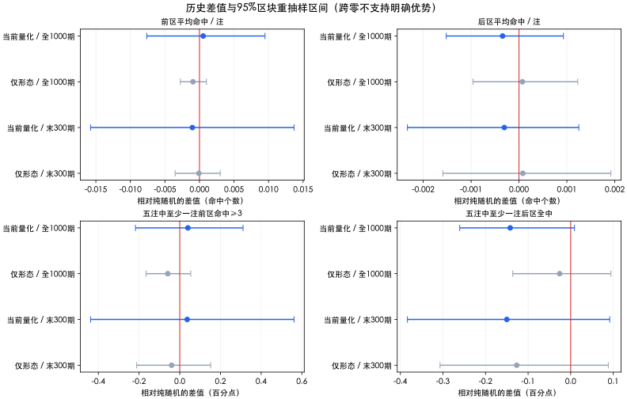
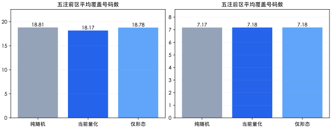

# 历史回测与随机对照报告

评估日期：2026-10-28。本报告冻结评估当时的原量化规则与解释性对照。文中“当前量化”均指回测时的V1，不是后续新版。复现脚本已锁定baseline-lotto.ts原代码；后续产品调整不改变这里的历史结果。

## 结论

**在本次1000期历史样本、每期5注预算与所设模拟方案下，没有观察到当前量化逻辑稳定优于纯随机的命中优势。** 全段前区平均命中仅高0.000538个/注，最新300期反而低0.001030个/注；这些差异的区块重抽样区间均跨过零，不能据此宣布提高或降低未来命中率，也不构成两者完全等效的证明。

较明确的产品发现是：**当前量化把五注前区覆盖从18.81个不同号码压缩到18.17个，且本次生成结果100%达到现有规则100分。** 分数表达的是满足规则，不是准确率；热号约束使组合更集中。

## 数据与核验

- 来源：[中国体彩网公开历史查询](https://www.lottery.gov.cn/kj/kjlb.html?dlt)所用gameNo=85历史接口；11页、每页100条。原始响应已压缩归档，逐页保存URL和SHA256。
- 实际下载1100期，选最新1050期用于研究：19110期（2019-09-21）至26123期（2026-10-28）。最早50期仅作预热，其后1000期为目标期。
- 目标期范围：20010期（2020-03-14）至26123期（2026-10-28）。较早700期截至24125期；末段300期为24126期（2024-10-30）至26123期。
- 校验了彩种、号码范围、区内去重、期号/日期唯一性和顺序、同年期号连续及跨年001衔接；与项目中已核验的福建官方快照逐期比较了重叠50期，日期和号码完全一致。其余1000期未逐期做独立双源复验。跨年衔接不等于独立确认上一年最后期号。
- `data/history.json`中的fetchedAt及结果generatedAt是整理/运行时间，不是官方开奖发布时间，也不是原始响应的可独立证明下载时间。归档哈希证明所保存文件的完整性，不单独证明抓取时间。

## 实验如何保证可比较

1. 每个目标期只读取**之前50期**，按生产代码的最新在前顺序构造热号；当期及未来结果不进入生成输入。按时间隔离输入的理由参见[时间序列验证文档](https://scikit-learn.org/stable/modules/generated/sklearn.model_selection.TimeSeriesSplit.html)。
2. 纯随机和当前量化直接调用现有`generateLottoSets`，未另写一个近似算法替代。第三组只把热号评分贡献固定为25分，保留原和值/奇偶/连号规则、采样方式、最多100候选和≥90提前停止机制。
3. 每期每方法5注，重复200轮，三方法各100万注，共300万注。**相同的是每期注数/投注预算，计算量不同**：随机每注1个候选，筛选每注最多100个。
4. 各方法在同一轮/同一期使用相同伪随机流起点，便于配对；采用可复现Mulberry32和固定种子函数。200000组轮次/期号有199992个不同32位种子，即8次跨组合碰撞，影响微小；不声称所有流严格独立。
5. **真实历史样本仍是1000期，末段仍是300期。** 200轮仅减少固定历史结果上的模拟抽样误差，不能视为200份独立历史。
6. 方案在计算结果前内部固定，但没有外部预注册。最新300期是本次预先指定的**回溯末段检查**，不是前瞻验证，也不能证明规则设计者从未见过这些历史结果。没有据本次结果调参后再反复挑选同一末段。
7. 不计算投注收益、回本率或跨年奖级：历史奖级/奖金额度发生过变化，且本次未导入逐期奖金。下列事件是号码匹配指标，不能直接当成中奖率或某一奖级。

## 全段结果：1000期

| 方法 | 前区平均命中/注 | 后区平均命中/注 | 五注至少一注前区≥3 | 五注至少一注后区全中 | 单注前区≥3且后区≥1 |
| --- | --- | --- | --- | --- | --- |
| 纯随机 | 0.713909 | 0.333335 | 6.662% | 7.437% | 0.4299% |
| 当前量化 | 0.714447 | 0.332992 | 6.702% | 7.295% | 0.4420% |
| 仅形态（移除热号约束） | 0.712967 | 0.333406 | 6.603% | 7.411% | 0.4365% |

前区均值的纯随机理论基准为25/35≈0.714286，后区为4/12≈0.333333；模拟随机结果与之接近。随机五注至少一注前区≥3的理论值约6.743%，后区全中约7.350%，用于抽样实现的量级校准，不把有限模拟与理论值的差异当成策略优势。

## 末段检查：最新300期

| 方法 | 前区平均命中/注 | 后区平均命中/注 | 五注至少一注前区≥3 | 五注至少一注后区全中 | 单注前区≥3且后区≥1 |
| --- | --- | --- | --- | --- | --- |
| 纯随机 | 0.712040 | 0.333457 | 6.525% | 7.537% | 0.4147% |
| 当前量化 | 0.711010 | 0.333150 | 6.562% | 7.387% | 0.4240% |
| 仅形态（移除热号约束） | 0.711953 | 0.333537 | 6.485% | 7.410% | 0.4247% |

全段当前量化前区均值略高，末段略低，方向未保持；移除热号约束的组也没有显示明确的命中提升，**本报告不据此宣布一个新的胜出算法**。后区三组均为随机抽取，数值差异来自有限模拟，不能解释成已验证的后区预测能力差异。

## 差异是否足够可靠

先对每期200轮求平均，再以期为单位计算“当前量化−随机”的配对差；采用长度20期、2000次移动区块bootstrap，尽量保留相邻期依赖。红色零线右侧表示历史点估计较高，区间穿零表示本方法下不足以区分。



全段差值：

| 当前量化减纯随机 | 历史差值 | 95%区块重抽样区间 |
| --- | --- | --- |
| 前区平均命中 | +0.000538 个/注 | [-0.007622, +0.009492] 个/注 |
| 后区平均命中 | -0.000343 个/注 | [-0.001519, +0.000927] 个/注 |
| 五注至少一注前区≥3 | +0.040000 个百分点 | [-0.217537, +0.311037] 个百分点 |
| 五注至少一注后区全中 | -0.142000 个百分点 | [-0.260537, +0.009012] 个百分点 |
| 单注前区≥3且后区≥1 | +0.012100 个百分点 | [-0.011303, +0.033503] 个百分点 |

末段差值：

| 当前量化减纯随机 | 历史差值 | 95%区块重抽样区间 |
| --- | --- | --- |
| 前区平均命中 | -0.001030 个/注 | [-0.015768, +0.013693] 个/注 |
| 后区平均命中 | -0.000307 个/注 | [-0.002330, +0.001250] 个/注 |
| 五注至少一注前区≥3 | +0.036667 个百分点 | [-0.438333, +0.561750] 个百分点 |
| 五注至少一注后区全中 | -0.150000 个百分点 | [-0.383375, +0.091667] 个百分点 |
| 单注前区≥3且后区≥1 | +0.009333 个百分点 | [-0.035675, +0.051667] 个百分点 |

两个主指标是前区/后区每注平均命中。其他指标和分段用于解释，未作全套多重比较校正，不以某一条突出结果作上线依据。即使将两个主指标区间扩为97.5%来收紧双指标判断，全段及末段仍都跨零，结论不变；该扩展仅为报告中的补充保守检查。

区块长度20依赖近似平稳性假设，不保证已覆盖50期滚动窗口引入的全部依赖；有限样本、随机数实现和区块选择都会影响区间。区间描述给定数据与重抽样设定下的历史不确定性，不是未来开奖承诺。未发现显著优势，不等于证明差异严格为零。

## 组合分布：比命中均值更清楚的发现

| 方法 | 五注前区不同号码数 | 五注后区不同号码数 | 符合当前全部满分规则比例 |
| --- | --- | --- | --- |
| 纯随机 | 18.8095 | 7.1735 | 18.84% |
| 当前量化 | 18.1713 | 7.1765 | 100.00% |
| 仅形态（移除热号约束） | 18.7797 | 7.1817 | 42.15% |



当前量化五注前区平均少覆盖0.6381个号码，约减少3.39%；移除热号约束后恢复到18.78个。当前量化与随机的覆盖差95%区间为[-0.6495, -0.6288]个，显示本次样本中集中效应较稳定。**覆盖更广不等于单注中奖率更高**，只说明五注之间的分散程度。

现有评分可能值中90以上只有100，因此“≥90停止”几乎就是等待满分；本次当前量化100万注全部满分。纯随机约18.84%也能满足现有满分规则。它是规则符合度，不能为预测准确性提供证据。

三组均未观察到同一五注内的完整重复组合；该事件本来就很罕见，不能把“加去重”描述为本次已证实能大幅提升命中。

## 分年检查（描述性）

| 年份 | 真实目标期数 | 随机前区均值 | 当前前区均值 | 当前减随机 |
| --- | --- | --- | --- | --- |
| 2020 | 125 | 0.71438 | 0.72455 | +0.01018 |
| 2021 | 150 | 0.71419 | 0.71825 | +0.00407 |
| 2022 | 150 | 0.71568 | 0.70225 | -0.01343 |
| 2023 | 150 | 0.71646 | 0.73512 | +0.01866 |
| 2024 | 152 | 0.71183 | 0.69967 | -0.01216 |
| 2025 | 150 | 0.71393 | 0.71481 | +0.00088 |
| 2026 | 123 | 0.71037 | 0.70702 | -0.00335 |

各年期数不同，不能挑选其中表现最好的年份作为未来承诺。全段与末段才是本次预定的主要时间范围。

## 可讨论的优化方向

| 优先级 | 方向 | 本次证据与边界 |
| --- | --- | --- |
| 优先 | 处理100分展示/解释 | 满分几乎恒定，缺少区分度；可改为明确的规则符合度或逐条原因，不表示准确率。属于表达清晰度改进。 |
| 优先 | 五组联合控制重叠与覆盖 | 当前前区覆盖低于随机；可设计“同样5注、更分散”的候选方案再测。目标是组合多样性，不宣称单注预测提升。 |
| 可实验 | 放松热号硬约束 | 消融组覆盖恢复，但未证明命中更高。可把热号作为展示参考或降低约束，需讨论目标后再决定。 |
| 谨慎 | 调整历史窗口/经验阈值 | 30/50/100期、动态和值区间等本次未测试，属于新假设；不能用这份报告替它们背书。需另留检验期，防止在同一末段上反复调参。 |
| 不优先 | 给遗漏/后区冷热增加预测权重 | 本次没有支持证据；未测试的复杂规则不因“用更多历史”就更有效。 |
| 长期 | 保存生成版本、数据截止期号和目标期 | 可支持之后真正按时间前进的验证、对账和复现，避免事后挑选记录。 |

**建议讨论顺序：先明确希望优化“组合分散”还是“历史匹配指标”，再决定评分表达与热号约束如何调整。本报告阶段不直接替换生成器；后续用户确认后的实现另见quantified-v2-engineering-check.json。**

## 完整命中分布（各组100万注）

| 前区命中数 | 纯随机 | 当前量化 | 仅形态（移除热号约束） |
| --- | --- | --- | --- |
| 0 | 43.9112%（439,112注） | 43.8613%（438,613注） | 43.9565%（439,565注） |
| 1 | 42.2107%（422,107注） | 42.2693%（422,693注） | 42.1983%（421,983注） |
| 2 | 12.5053%（125,053注） | 12.4766%（124,766注） | 12.4828%（124,828注） |
| 3 | 1.3218%（13,218注） | 1.3490%（13,490注） | 1.3169%（13,169注） |
| 4 | 0.0508%（508注） | 0.0438%（438注） | 0.0454%（454注） |
| 5 | 0.0002%（2注） | 0.0000%（0注） | 0.0001%（1注） |

| 后区命中数 | 纯随机 | 当前量化 | 仅形态（移除热号约束） |
| --- | --- | --- | --- |
| 0 | 68.1952%（681,952注） | 68.2056%（682,056注） | 68.1847%（681,847注） |
| 1 | 30.2761%（302,761注） | 30.2896%（302,896注） | 30.2900%（302,900注） |
| 2 | 1.5287%（15,287注） | 1.5048%（15,048注） | 1.5253%（15,253注） |

在公平、独立开奖的前提下，合法固定单注的理论命中分布相同，头奖概率为1/21,425,712。100万注理论头奖期望不足0.05次，本次规模不适合识别头奖优势；不能以“有没有碰巧中头奖”评价算法。

## 复现与文件

- 预定方案：[protocol.md](protocol.md)
- 原始归档与来源哈希：[data/manifest.json](data/manifest.json)，同目录11份page-XX.json.gz。
- 规范化研究数据：[data/history.json](data/history.json)
- 逐期/逐轮模拟汇总：[results.json](results.json)；区间及分年统计：[analysis.json](analysis.json)。
- 回测所用原生成器SHA256：`88752debf93c50d3c9db2571b7496e33a0c5db579c8a9fd734d1ef7abbed73be`；记录的Git基线：`d8a11082951522b1231ff86a5dbc0b0788e5f2ec`。
- 研究脚本、方案、数据、结果及运行环境哈希见：[reproducibility.json](reproducibility.json)。研究脚本尚未提交，单靠Git基线不足以复现，须保留本目录与scripts/research文件。

在项目根目录运行：

```sh
node --import tsx --test scripts/backtest.test.ts
node --import tsx scripts/research/run-backtest.ts
python3 scripts/research/analyze-backtest.py
python3 scripts/research/render-backtest-report.py
```

分析脚本需要numpy和matplotlib；报告生成仅使用Python标准库。运行会使用已归档原始响应，不再次联网；生成时间元数据可能变化，固定种子下指标数值可重现。归档分页URL已保存，可另行重新获取，但新增开奖后分页内容会变，不能用新下载的分页冒充原数据。
