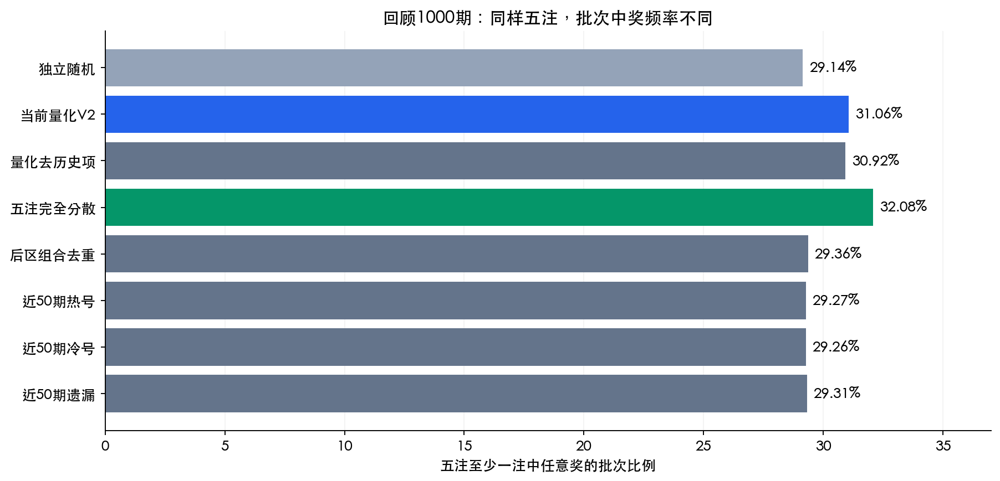
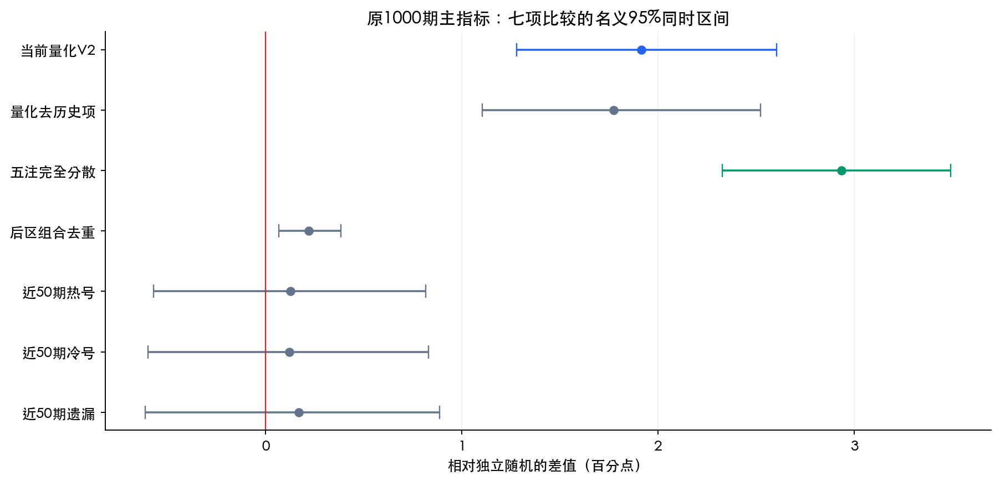
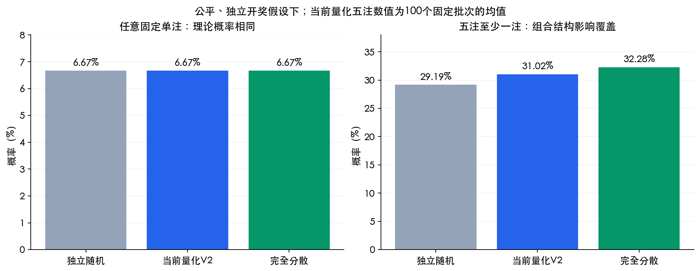

# 历史回测与随机对照报告 V3

2026-11-11 · 数据核验截止 2026-11-11 15:50（北京时间） · 生产基线 30a30b1

尚未找到历史冷热或遗漏策略提高单注中奖概率的证据。进一步可验证的空间在“五注如何组合”：完全分散的五注任意奖概率为32.28%；当前量化100个固定批次的均值为31.02%，样本均值相差约1.26个百分点。

上述数学概率依赖公平、独立开奖假设。任意奖包含最低奖，中奖不等于回本或盈利。任意固定单注的理论概率均为6.67%；五个不同完整组合的头奖概率均为5/21425712。完全分散只改变同一批次的中奖集中程度，五注期望中奖注数仍为0.333524，未增加。

## 本次样本与方法

原始已归档1100期重新验SHA256；原1050期规范化数据加5期新增，共1055期。前50期预热，回测目标1005期（20010 / 2020-03-14 至 26128 / 2026-11-09）。中央最新100期与旧档95期重叠一致，福建最新50期和已发布50期全部交叉核对一致。

原1000期每期每方法50轮；新增5期每期1000轮；每轮五注。每方法合计275000模拟注，八方法合计2200000注。模拟轮次用于减小抽样噪声，不能增加独立历史样本数。各段按真实期次先平均，未用重复次数给新增期加权。

- 当前量化直接调用生产生成器；去历史项量化仅将热号集合置空，其余形态与组间分散算法不变。
- 完全分散：均匀抽取25个不重复前区号、10个不重复后区号，按随机顺序分成五注。单注仍均匀随机；仅适用于本轮五注预算。
- 后区组合去重：允许单个后区号跨注重叠，但五个二元组合不同；前区独立随机。
- 热号、冷号、遗漏只使用此前50期，按平均名次给前后区0.75–1.25的弱权重，不做窗口或参数搜索。遗漏未在50期出现时统一截断50。

## 原1000期：回顾性比较

| 方法 | 单注任意奖 | 五注至少一注任意奖 | 相对随机差值 | 差值同时区间：百分点 |
| --- | --- | --- | --- | --- |
| 独立随机 | 6.67% | 29.14% | 基准 | — |
| 当前量化V2 | 6.68% | 31.06% | +1.91 个百分点 | [+1.28, +2.61] |
| 量化去历史项 | 6.66% | 30.92% | +1.77 个百分点 | [+1.10, +2.52] |
| 五注完全分散 | 6.64% | 32.08% | +2.94 个百分点 | [+2.33, +3.49] |
| 后区组合去重 | 6.67% | 29.36% | +0.22 个百分点 | [+0.07, +0.38] |
| 近50期热号 | 6.71% | 29.27% | +0.13 个百分点 | [-0.57, +0.82] |
| 近50期冷号 | 6.71% | 29.26% | +0.12 个百分点 | [-0.60, +0.83] |
| 近50期遗漏 | 6.75% | 29.31% | +0.17 个百分点 | [-0.61, +0.89] |

原1000期在上一轮研究中已经使用，原末300期也参与过V2工程检验，均为回顾/探索性结果。表内区间针对五注任意奖主指标的七项对随机比较：按真实期次聚类、长度20期移动区块bootstrap20000次，采用Bonferroni名义95%同时区间；不能据此推断未来稳定预测能力。

另做长度50期、5000次区块敏感性分析，完整95%区间见analysis.json。近似bootstrap p值以零假设中心化差值计算并作Holm校正，离散并列值用1e-12容差；这些p值不是精确检验，尾部分位数仍有重抽样数值误差。末300期、分年、次指标均属探索性，未纳入该七项主比较的同时覆盖声明。

## 末300期与新增5期

| 方法 | 原末300期：五注任意奖 | 新增5期：五注任意奖 | 新增5期：单注任意奖 |
| --- | --- | --- | --- |
| 独立随机 | 29.61% | 29.20% | 6.56% |
| 当前量化V2 | 30.91% | 30.76% | 6.67% |
| 量化去历史项 | 30.45% | 30.84% | 6.70% |
| 五注完全分散 | 32.29% | 31.24% | 6.48% |
| 后区组合去重 | 29.84% | 29.30% | 6.59% |
| 近50期热号 | 29.25% | 29.66% | 6.86% |
| 近50期冷号 | 29.57% | 27.50% | 6.22% |
| 近50期遗漏 | 29.29% | 28.88% | 6.56% |

新增段为26124、26125、26126、26127、26128，日期2026-10-31至2026-11-09。当前V2在这些期次之前已固定；本轮新候选策略是事后提出，且检索中已经看到公开最新结果，因此不能称预注册前瞻或盲测。新增5期只作描述，不作强显著性判断。

## 与历史结果独立的数学核算

均匀随机五注的平均批次概率可解析求出：29.19%；只去重后区组合为29.40%；前后区完全分散为32.28%（精确分数987995/3060816）。完全分散相对独立随机提高3.09个百分点。

当前量化100个预先固定生成批次的条件概率均值为31.02%；完全分散比这份样本均值高1.26个百分点（相对约4.1%）。这不是当前生成器总体均值的精确估计，也不是某一期中奖保证。

| 方法 | 100批次条件概率均值 | 这100批次的最小–最大值 |
| --- | --- | --- |
| 独立随机 | 29.24% | 25.75%–31.01% |
| 当前量化V2 | 31.02% | 29.15%–31.91% |
| 量化去历史项 | 30.97% | 28.01%–31.91% |
| 五注完全分散 | 32.28% | 32.28%–32.28% |
| 后区组合去重 | 29.47% | 26.93%–31.37% |
| 近50期热号 | 29.24% | 25.01%–31.03% |
| 近50期冷号 | 29.15% | 26.26%–31.25% |
| 近50期遗漏 | 29.24% | 26.70%–31.20% |

每个固定批次都完整计算C(35,5)×C(12,2)=21425712种等可能结果的中奖事件数量；枚举通过前区命中状态压缩，与全枚举等价。100批次/方法取自原1000期中等距20个仅含此前数据的上下文，每上下文5种子。表中的最小–最大值及JSON中的p025/p975为这100个批次条件概率的分布，不是生成器总体均值的置信区间。

任意固定单注中奖概率精确为6187/92752（约6.670476%）。五注预期中奖注数约0.333524保持不变；分散让中奖更少集中在同一批次的多注上。利用并集上界，五注至少一注中奖不超过五注预期中奖注数约33.35%；这是粗上界，不是已证明可达到的优化目标。单注头奖为1/21425712，五个不同完整组合至少一注头奖为5/21425712，不随冷热、形态或分散方法提高。

## 可以优化的方向

### 优先讨论：五注完全分散

回顾1000期五注中奖批次为32.08%，当前量化为31.06%；原末300期为32.29%对30.91%。精确条件概率核算也显示结构性覆盖优势。若采用，目标应写成“同预算五注更容易至少中一注，包含最低奖”，不能写成提高单注或头奖概率。本轮未证明它是所有五注组合中的全局最优。

### 暂不强化：热号、冷号、遗漏

三种历史加权对随机的主指标同时区间均跨0，末300期方向也不一致；去掉当前量化的历史项后结果接近，不能据微小差异证明热号有效。没有理由据本轮结果再加大历史权重或引入更复杂预测模型。

### 继续积累：上线后的真实新期次

目前仅新增5期，即使每期重复1000次，真实时间样本仍为5。此段当前量化30.76%、完全分散31.24%，不足以支持稳定性结论。后续应冻结方案后继续积累新开奖；本报告不改生产算法。

## 规则依据与可复现文件

任意中奖事件统一为前区≥3，或前区≥2且后区≥1，或后区=2。[官方游戏规则](https://m.lottery.gov.cn/ksjz/m/yxgz_dlt/)列明相应13种中奖条件；2026年自26014期调整九个奖级为七个，[官方说明](https://www.nmtc.com.cn/zxdt/30026.html)确认13种中奖条件保持不变。本次数据最早2019年9月，按统一中奖事件比较，不混算不同时期奖金、追加投注、派奖或收益率。

- protocol.md：计算前固定方案；data/manifest.json及压缩原始响应：数据审计。
- results.json：逐期均值、原1000期/末300期/新5期联合命中分布、每轮汇总和输入哈希。
- analysis.json：聚类区间、多重比较、区块敏感性、分年及模拟误差。
- theory-batches.json、exact-probabilities.json：800个预先固定批次和精确条件概率。
- reproducibility.json：全部研究脚本、生产基线、数据与结果的SHA256及复现命令。

本报告保留旧报告，不改动当前量化模式、页面、生产开奖数据或部署配置。
